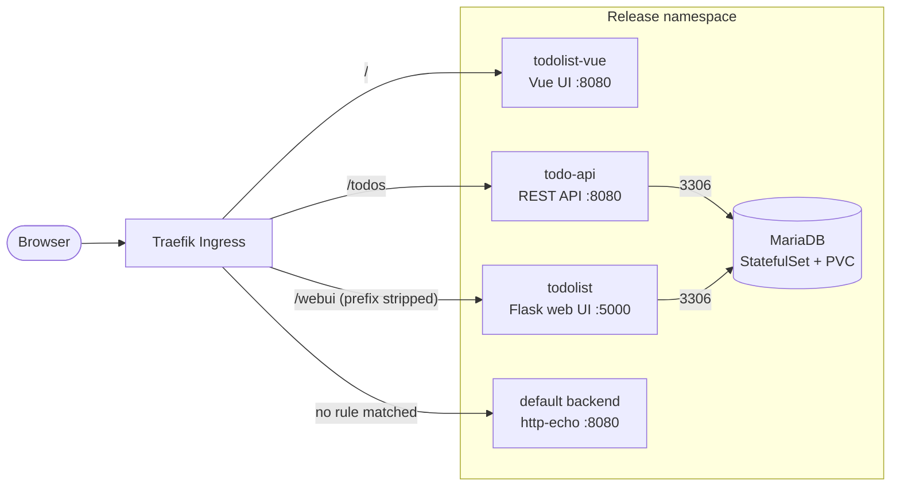

# Todolist on Kubernetes

A multi-tier to-do application deployed on Kubernetes three ways: plain manifests, Kustomize overlays, and a fully parameterised Helm chart with path-based ingress, autoscaling, and network isolation.

This was the capstone project for a university Kubernetes course. The application container images were provided as part of the course; everything in this repository — the manifests, overlays, and Helm chart — is the deployment work.


## Architecture

The Helm chart is the final form of the project. Traefik routes requests by path to three services, and only two of them are allowed to reach the database.



| Component | Workload | Details |
|---|---|---|
| Vue UI | Deployment + HPA | Served at `/`; calls the API through the ingress |
| REST API | Deployment + HPA | Served at `/todos` |
| Flask web UI | Deployment | Served at `/webui` through a Traefik `stripPrefix` middleware |
| MariaDB | StatefulSet | Headless Service, 1Gi volume from a `volumeClaimTemplate` |
| Default backend | Deployment | Answers requests that match no ingress rule |

## What it demonstrates

- **Stateful workloads** — MariaDB runs as a StatefulSet with a headless Service and a per-pod persistent volume.
- **Ingress routing** — four Ingress resources with explicit Traefik router priorities, a `stripPrefix` middleware, and a default backend.
- **Network isolation** — NetworkPolicies allow database traffic only from the API and the web UI, and allow application traffic only from the Traefik namespace. Egress from the application pods is limited to the database and cluster DNS.
- **Autoscaling** — CPU-based HorizontalPodAutoscalers, backed by resource requests and limits.
- **Health and startup ordering** — readiness and liveness probes on every tier, and init containers that wait for a dependency before the main container starts.
- **Configuration and secrets** — ConfigMaps for settings, Secrets for credentials, and a binary ConfigMap mounted as a file. No credential is stored in this repository.
- **Backups** — a nightly CronJob copies the database volume to a separate backup volume (Kustomize overlay).
- **Three packaging approaches** — the same application as raw YAML, as layered Kustomize overlays, and as a Helm chart.

## Repository layout

```
.
├── todolist-chart/        Helm chart (final version)
│   ├── Chart.yaml
│   ├── values.yaml
│   └── templates/
├── base/                  Kustomize base: Deployment-backed MariaDB + web UI
├── overlays/
│   ├── 1-sts/             Swaps MariaDB to a StatefulSet, adds the backup CronJob
│   └── 2-hpa/             Builds on 1-sts: resources, probes, HPA
└── manifests/             Earlier single-file manifests and kubectl patches
    ├── todolist.yaml
    ├── todolist-hpa.yaml
    └── patches/
```

## Prerequisites

- A Kubernetes cluster (developed on [minikube](https://minikube.sigs.k8s.io/))
- `kubectl` and [Helm 3](https://helm.sh/)
- [Traefik](https://doc.traefik.io/traefik/) installed in a namespace named `traefik`, with its CRDs — required by the Helm chart
- [metrics-server](https://github.com/kubernetes-sigs/metrics-server) — required for the autoscalers
- A CNI plugin that enforces NetworkPolicy, such as Calico — otherwise the policies are accepted but have no effect

On minikube:

```bash
minikube start --cni=calico
minikube addons enable metrics-server

helm repo add traefik https://traefik.github.io/charts
helm install traefik traefik/traefik -n traefik --create-namespace
```

## Deploy with Helm

The database password has no default and must be supplied at install time.

```bash
helm upgrade --install todolist ./todolist-chart \
  -n todolist --create-namespace \
  --set MY_SQL_ROOT_PASSWORD='<your-password>'
```

Get the Traefik URL and open the application:

```bash
minikube service -n traefik traefik --url
```

| Path | Serves |
|---|---|
| `/` | Vue UI |
| `/todos` | REST API |
| `/webui` | Flask web UI |

Check the release:

```bash
kubectl -n todolist get pods,svc,deploy,sts,ingress,netpol,hpa
```

### Configuration

| Value | Default | Description |
|---|---|---|
| `MY_SQL_ROOT_PASSWORD` | `""` | Database root password. Required. |
| `USER` | `"Maman Rani"` | Name shown in the UI |
| `API_BASE_URL` | `/todos` | Path the Vue UI uses to reach the API |
| `service.type` | `LoadBalancer` | Service type for the application services |
| `ingress.className` | `traefik` | Ingress class |
| `ingress.host` | `""` | Hostname for the ingress rules; empty matches any host |
| `hpa.enabled` | `true` | Create the HorizontalPodAutoscalers |
| `hpa.<component>.minReplicas` / `maxReplicas` | `1` / `3` | Scaling bounds |
| `hpa.<component>.targetCPUUtilizationPercentage` | `75` | CPU target |
| `networkPolicy.enabled` | `true` | Create the NetworkPolicies |
| `titleImage.base64` | `""` | Optional base64-encoded PNG shown in the Vue UI header |
| `images.<component>.repository` / `tag` | see `values.yaml` | Image for each component |
| `resources.<component>` | see `values.yaml` | Requests and limits |

To keep personal overrides out of Git, put them in `todolist-chart/values.local.yaml` (ignored by `.gitignore`) and pass it with `-f`.

## Deploy with Kustomize

Each overlay builds on the previous one, so the steps of the project can be applied one at a time.

| Target | Adds |
|---|---|
| `base` | Namespace, config, MariaDB as a Deployment with a PVC, web UI exposed on a NodePort |
| `overlays/1-sts` | Replaces the MariaDB Deployment with a StatefulSet and headless Service; adds a nightly backup CronJob and backup volume |
| `overlays/2-hpa` | Adds resource requests and limits, readiness and liveness probes, and an HPA (2–4 replicas, 50% CPU) |

The password comes from a local file that is not committed:

```bash
cp base/secret.env.example base/secret.env   # then edit the password
kubectl apply -k overlays/2-hpa
minikube service -n todolist frontend --url
```

## Plain manifests

`manifests/` holds the earlier single-file version and the `kubectl patch` files used along the way.

```bash
kubectl create namespace todolist
kubectl -n todolist create secret generic todolist-secret \
  --from-literal=MYSQL_ROOT_PASSWORD='<your-password>'
kubectl apply -f manifests/todolist.yaml

# Examples of the incremental patches
kubectl -n todolist patch deployment frontend --type=json \
  --patch-file manifests/patches/frontend-resources.patch.json
kubectl -n todolist patch service frontend \
  --patch-file manifests/patches/svc-lb.patch.json
kubectl apply -f manifests/todolist-hpa.yaml
```

## Cleanup

```bash
helm uninstall todolist -n todolist     # Helm
kubectl delete -k overlays/2-hpa        # Kustomize
kubectl delete namespace todolist       # removes everything, including volume claims
```

## Known limitations

This is a learning project, and a few choices reflect that:

- The application connects to MariaDB as `root`, with remote root access enabled by an init script. A production setup would use a dedicated, least-privilege database user.
- The MariaDB image is pinned to `latest` rather than a specific version.
- The backup CronJob copies the live data directory instead of taking a logical dump, so a backup taken during a write may not be consistent.
- MariaDB runs as a single replica with no replication or failover.

## Author

**Rani Maman** — [github.com/Rani-Maman](https://github.com/Rani-Maman)
